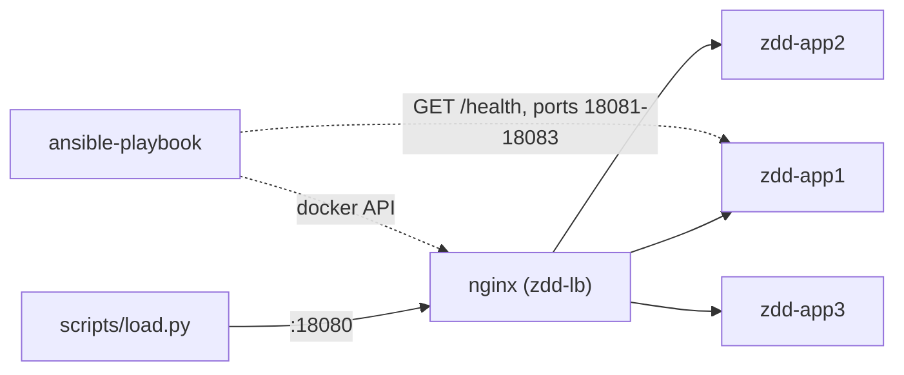
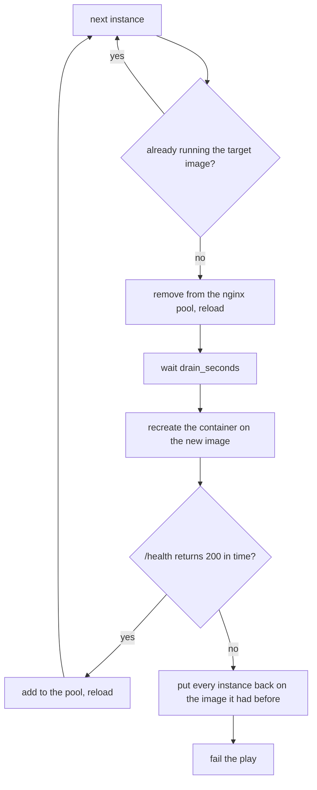

# zero-downtime-deploy-ansible

Rolling deploy of a small Python web app with Ansible: three containers behind nginx, all on the local Docker daemon. A request loop runs during the deploy and counts failed requests. A deliberately naive deploy is there for comparison.

## The problem

`docker rm` followed by `docker run` (or `docker-compose down && up`) leaves a gap where nothing answers, and nginx keeps sending requests to addresses that no longer exist. Avoiding that takes two things: pull one instance out of the balancer before touching it, and put it back only when its health check passes. If the new release never gets healthy, the old one has to come back without anyone doing it by hand.

## How it works



Per instance, `deploy.yml` does this:



Some details that matter:

- The pool is a list kept by the playbook (`lb_pool`) and rendered into the nginx upstream. Only running instances are in it, because nginx resolves the container names while loading its config.
- nginx is reloaded, not restarted. Old workers finish their requests, new ones use the new list.
- The second run of the same release changes nothing: instances are compared by image, the config is only rewritten (and nginx reloaded) when its content differs.
- Rollback goes through all instances, last first, so a release that breaks on the second instance does not leave the first one on the new version.
- `broken_on` makes the listed instances start the new release with `/health` failing. That is how the rollback is tested.
- `deploy_naive.yml` removes all containers, starts the new ones and reloads nginx. No draining, no health wait.

## Quick start

Needs Python 3.9+, make and a Docker daemon. Ports 18080 to 18083 on 127.0.0.1 must be free.

```sh
python3 -m venv .venv && . .venv/bin/activate
pip install -r requirements.txt
ansible-galaxy collection install -r requirements.yml

make demo      # the full scenario below, takes a few minutes
make clean     # removes containers, network, images and .state
```

By hand, from `ansible/`:

```sh
ansible-playbook deploy.yml -e app_version=v1
curl http://127.0.0.1:18080/

# terminal 2: requests until the stop file appears
python3 ../scripts/load.py --stop-file /tmp/zdd.stop

# terminal 1
ansible-playbook deploy.yml -e app_version=v2
touch /tmp/zdd.stop            # terminal 2 prints the counts
```

`scripts/demo.sh` points `DOCKER_HOST` at the Colima socket when there is no `/var/run/docker.sock`. `ansible-playbook` does not, so with Colima export it yourself: `export DOCKER_HOST=unix://$HOME/.colima/default/docker.sock`.

## Verified

The local runs below were on a Mac with Colima (Docker 29.5.2), Python 3.9.6, ansible-core 2.15.13 and community.docker 3.13.1. The output is pasted as it came out.

Static checks:

```sh
make lint        # yamllint . ; ansible-lint -> "Passed: 0 failure(s), 0 warning(s) on 22 files"
make syntax      # ansible-playbook --syntax-check for both playbooks, no errors
actionlint .github/workflows/ci.yml    # 1.7.12, no findings
```

The scenario, `make demo`. Each deploy is followed by requests through nginx, and the script stops with an error if a check fails:

```
== 1. first deploy of v1
localhost : ok=39 changed=10 unreachable=0 failed=0 skipped=17 rescued=0 ignored=0
== 2. same release again, nothing should change
localhost : ok=18 changed=0 unreachable=0 failed=0 skipped=26 rescued=0 ignored=0
== 3. rolling deploy v1 -> v2 under load
requests=12238 ok=12238 failed=0 duration=114.8s
versions: v1=7914 v2=4324
  nginx retried on another instance: 0 requests
localhost : ok=66 changed=22 unreachable=0 failed=0 skipped=2 rescued=0 ignored=0
== 4. naive deploy v2 -> v3 under load (control, failures expected)
requests=3092 ok=3079 failed=13 duration=32.3s
versions: v2=2370 v3=709
  5x HTTPError: HTTP Error 502: Bad Gateway
  5x HTTPError: HTTP Error 504: Gateway Time-out
  3x timeout: timed out
  nginx retried on another instance: 229 requests
== 5. v4 never gets healthy on any instance
requests=5870 ok=5870 failed=0 duration=40.0s
versions: v3=5870
  nginx retried on another instance: 0 requests
rolled back, failed task: Wait until healthy app1
localhost : ok=35 changed=9 unreachable=0 failed=1 skipped=20 rescued=1 ignored=0
== 6. v4 is fine on app1 but broken on app2
requests=10532 ok=10532 failed=0 duration=83.0s
versions: v3=8164 v4=2368
  nginx retried on another instance: 0 requests
rolled back, failed task: Wait until healthy app2
localhost : ok=68 changed=22 unreachable=0 failed=1 skipped=12 rescued=1 ignored=0
== all checks passed
```

What this shows:

- Second run of the same release: `changed=0`.
- Rolling v1 to v2 with requests flowing the whole time: 12238 requests, 0 failed, both versions answered during the roll. nginx never had to retry a request on a second instance, so the pool update itself was correct and not just covered by nginx's retry.
- Naive v2 to v3: 13 of 3092 requests failed (502, 504 and client timeouts), and nginx retried 229. The failed count changes a lot from run to run. In the runs I did while building this it was between 13 and 299, so only "not zero" is stable. The laptop was busy with other work during these runs, so the durations are longer than on a quiet machine.
- v4 broken on every instance: the first instance fails its health check and goes back to v3. No request failed and none was served by v4.
- v4 healthy on app1, broken on app2: app1 served v4 for a while (2368 requests), app2 failed, and both went back to v3 with no failed request.

By hand, outside the script: a broken first deploy (`-e '{"broken_on": ["app1"]}' -e health_retries=4`) fails and leaves no containers behind.

On GitHub Actions the workflow went green on its first run: [run 42963651964](https://github.com/Walaskien/zero-downtime-deploy-ansible/actions/runs/42963651964), ubuntu-24.04 runner image 20261101.360.1, Python 3.11, same pinned requirements. Lint, syntax check and `make demo` all passed, 3m27s for the job and 2m54s of that in the scenario. The numbers from that run:

- Rolling v1 to v2: 7684 requests, 0 failed, 0 retried by nginx.
- Naive v2 to v3: 206 of 2320 failed (200 of them 502), 320 retried by nginx.
- v4 broken everywhere, and broken only on app2: 0 failed requests in both, everything back on v3.

The run also shows a notice that the actions it uses (checkout, setup-python, upload-artifact) target Node.js 20, which GitHub is deprecating. It did not fail anything.

Not verified: the mermaid diagrams were not checked after GitHub rendered them, and nothing was run outside one Mac with Colima and one GitHub-hosted Ubuntu runner.

## Limitations

- The targets are containers on the local daemon. There are no remote hosts, so nothing here covers SSH, privilege escalation or a balancer on a separate machine.
- One nginx, not redundant. The reload is the one step all traffic depends on.
- nginx retries a failed connection on the next instance (`proxy_next_upstream`), which can hide a bad pool update from the client. That is why the demo also counts the requests nginx had to retry. Only GET requests are used; nginx does not retry POST by default.
- The health check is an HTTP call to the instance's own published port, not through nginx. It tells whether the app answers `/health`, nothing about its dependencies.
- The app is stateless. Database migrations, or a release that cannot run next to the previous one, need more than this.
- During a roll two versions answer at the same time (the `versions:` line shows it) and capacity is two instances out of three.
- A release is an image tag and tags are treated as immutable: an existing tag is not rebuilt. Only the image name is compared, other drift in a container is not corrected.
- Rollback restores the previous image. If the restored instance does not get healthy either, the play stops there and leaves it for a person.
- The numbers come from one laptop (macOS, Colima) and short runs with a small request loop. They say the mechanism works, not how it behaves under anything heavier.

## Layout

```
ansible/
  deploy.yml            rolling deploy with rollback
  deploy_naive.yml      the control case
  group_vars/all.yml    versions, ports, timings
  tasks/                roll_instance (one instance), set_pool (nginx config), prepare, run_nginx
  templates/nginx.conf.j2
app/                    the demo service and its Dockerfile
scripts/
  demo.sh               the scenario that CI runs
  load.py               request loop with failure counting
.github/workflows/ci.yml
```
